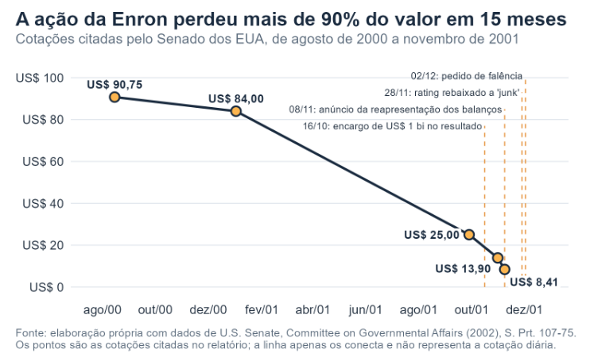

Por que confiar nos números de uma empresa? Quem compra ações ou empresta dinheiro a uma empresa raramente consegue conferir sozinho se os lucros divulgados são reais. Depende das informações que a própria companhia produz e de alguém independente que as verifique: o auditor. Quando essa verificação falha, o investidor passa a desconfiar de tudo, e a desconfiança tem preço.

Poucos casos mostram isso tão bem quanto o da Enron. Em 2 de dezembro de 2001, a empresa americana de energia pediu falência, a maior da história dos Estados Unidos até então, segundo o Senado do país. Pouco antes, ela figurava como a sétima maior companhia americana, com mais de US\$ 100 bilhões em receitas brutas e mais de 20 mil funcionários.

A história reúne três personagens: uma empresa que queria parecer uma potência financeira, um executivo vindo da consultoria McKinsey e uma firma de auditoria, a Arthur Andersen, que acumulava papéis que deveriam estar separados. Em dezembro, a quebra completa 25 anos, e suas lições seguem atuais para quem investe, empresta dinheiro ou regula o mercado.

##Da McKinsey ao lucro antecipado

Nos anos 1990, a Enron deixou de ser uma empresa tradicional de gasodutos e usinas para negociar contratos de energia como se fossem produtos financeiros. À frente dessa virada estava Jeffrey Skilling. Segundo a U.S. Securities and Exchange Commission (ou Comissão de Valores Mobiliários dos Estados Unidos), órgão que regula o mercado de capitais americano, ele trabalhou na McKinsey de 1979 a 1990 e, nesse período, prestou consultoria à própria Enron, que o contratou em agosto de 1990. Em fevereiro de 2001, Skilling se tornou o diretor-presidente da empresa.

Uma das primeiras mudanças foi contábil. Em 1991, a divisão de gás comandada por Skilling pediu à SEC para adotar a marcação a mercado, e a área contábil do órgão não se opôs, em janeiro de 1992. Com o método, a empresa lançava no resultado, já na assinatura de um contrato de longo prazo, o valor presente de todo o lucro que esperava obter com ele.

::: caixinha-lateral-esq
**“Tá, mas e a economia?” — Marcação a Mercado**

Marcação a mercado é a prática contábil de recalcular o valor de um ativo ou passivo pelo preço real que ele valeria se fosse negociado hoje (valor justo), registrando no balanço os ganhos ou perdas causados pelas oscilações do mercado antes mesmo da sua venda ou liquidação final.
:::

Essa prática funciona bem quando há preço de mercado para comparar, como uma ação na bolsa, mas sem esse preço, o valor vira estimativa da própria empresa. E era nesse quesito que estava o problema para a Enron. Uma vez que muitos desses contratos duravam anos e não tinham preço de mercado para comparação, o valor se tornou dependente de projeções da própria empresa. Na avaliação da equipe do Senado, a Enron, “no mínimo”, superestimou e “muito possivelmente” manipulou o valor dos contratos marcados a mercado.

No papel, os resultados impressionavam. As receitas brutas saltaram de US$40 bilhões em 1999 para US$ 100 bilhões em 2000. Esses números foram apresentados ao conselho de administração e, segundo o Senado, aparentemente nenhum conselheiro questionou o salto.

##Fora do balanço, até em Cuiabá

A outra marca do período foi a estratégia asset light, de manter poucos ativos no próprio balanço. Para isso, a Enron transferiu bilhões de dólares em ativos para empresas ligadas a ela, mas que ficavam fora das suas contas. Em outubro de 2000, cerca de US\$ 27 bilhões dos US\$ 60 bilhões em ativos do grupo, quase metade, estavam nessas entidades.

Algumas dessas operações carregavam um conflito de interesses evidente. O conselho autorizou o diretor financeiro, Andrew Fastow, a criar e administrar os fundos LJM, que faziam negócios com a Enron e lucravam à custa dela. O executivo responsável pelas finanças da empresa estava, ao mesmo tempo, do outro lado da mesa.

::: caixinha-lateral-dir
**“Tá, mas e a economia?” — Assimetria de Informação**

Acontece quando um lado de uma negociação sabe muito mais que o outro. É como comprar um carro usado: o vendedor conhece os defeitos, o comprador não. Sem confiança na informação, o comprador só aceita pagar menos.
:::

Uma dessas operações passou pelo Brasil. Em 1999, a LJM comprou uma participação na usina de Cuiabá, em Mato Grosso, o que permitiu à Enron tirar o projeto do balanço e, ainda assim, registrar ganhos. Em 2001, a Enron recomprou a participação por um preço muito maior, embora a obra tivesse enfrentado sérios problemas de construção, estouro de custos e dificuldades jurídicas.

Os investidores pouco sabiam disso. O Senado concluiu que o conselho permitiu, conscientemente, bilhões de dólares em operações fora do balanço para fazer a situação financeira parecer melhor do que era, sem garantir que essas obrigações fossem divulgadas de forma adequada ao público.

##O auditor que também era consultor

Quem deveria conferir esses números era a auditora externa, a Arthur Andersen. Mas a Enron estava entre os maiores clientes da firma: em 2000, pagou a ela cerca de US\$ 52 milhões, o equivalente a US\$ 1 milhão por semana. Segundo o Senado, os honorários de consultoria superaram os de auditoria pela primeira vez em 1999 e, em 2000, somaram cerca de US\$ 27 milhões, contra US\$ 25 milhões da auditoria.

Além da auditoria externa, a Andersen fazia a auditoria interna da Enron e prestava consultoria à empresa. Para o Senado, o conselho falhou ao permitir essa combinação, que comprometia a independência do auditor. A firma também ajudou a estruturar operações que melhoravam a aparência dos balanços, mas não tinham propósito econômico, como as chamadas Raptors. Na prática, conferia um trabalho do qual havia participado.

Sinais de alerta não faltaram. Em sua análise de risco, a própria Andersen descrevia parte dos negócios da Enron como transações de “forma acima da substância”, ou seja, possuíam a estrutura jurídica no papel capaz de ocultar brechas técnicas das regras contábeis (forma), ocultando a verdadeira saúde financeira da empresa (substância). Em fevereiro de 2001, 14 sócios da firma se reuniram para decidir se manteriam a Enron como cliente, discutiram o conflito de Fastow e chamaram os lucros da marcação a mercado de “aposta inteligente”. A conclusão foi manter o cliente. Depois da quebra, um comitê especial do conselho da Enron concluiu que a Andersen não cumpriu suas responsabilidades profissionais.

##O preço da desconfiança

O mercado demorou a reagir, e os analistas, mais ainda. A ação da Enron chegou a US\$ 90,75 em agosto de 2000 e terminou setembro de 2001 perto de US\$ 25. Em 17 de outubro, um dia depois de a empresa anunciar um encargo de US\$ 1 bilhão no resultado, os 15 principais analistas que a acompanhavam ainda recomendavam a compra da ação.

::: caixinha-lateral-esq
**“Tá, mas e a economia?” — Custo de Capital**

Custo de capital é a taxa mínima de retorno que uma empresa precisa gerar sobre seus investimentos para remunerar credores e acionistas (taxa de atratividade), funcionando na prática como o preço que o mercado cobra pelo risco de financiar o negócio.
:::

A partir daí, a queda acelerou. Em 31 de outubro, quando a Enron informou que a SEC havia aberto uma investigação formal, a ação valia US\$ 13,90. Em 8 de novembro, a empresa anunciou que refaria os balanços de mais de quatro anos, com redução de cerca de US\$ 500 milhões nos lucros, e a ação caiu para US\$ 8,41. No dia 28, as agências rebaixaram sua nota de crédito ao nível especulativo. Como no crediário, quem inspira menos confiança paga juros maiores. Quando ninguém acredita nos números da empresa, o dinheiro fica caro ou simplesmente desaparece. A fusão com a Dynegy, vista como salvação, foi cancelada.

Quatro dias depois, veio o pedido de falência. Para a equipe do Senado, a quebra tirou o emprego de milhares de pessoas, reduziu drasticamente suas economias para a aposentadoria, custou bilhões de dólares aos acionistas e provocou uma crise de confiança no mercado de capitais americano.

{width="100%" style="margin: 20px 0;"}

A principal resposta veio em 2002, com a Lei Sarbanes-Oxley. Ela proibiu as firmas de auditoria de prestar boa parte dos serviços de consultoria às empresas que auditam, obrigou o sócio responsável pela auditoria a mudar a cada cinco anos e criou um conselho independente, sob supervisão da SEC, para fiscalizar os auditores.

Vinte e cinco anos depois, a lição continua valendo para qualquer mercado, inclusive o brasileiro, por onde o caso também passou. O preço de uma ação depende do que a empresa promete, mas também de quanto o mercado acredita nos seus números. Quando quem confere também vende serviços a quem é conferido, essa confiança fica frágil, e, quando ela some, nenhuma estratégia sustenta o valor da empresa.

::: callout-tip
#### ODS 16 — Direcionamento Sustentável

O caso Enron se relaciona com a ODS 16, que busca instituições eficazes, responsáveis e transparentes. Auditores independentes e balanços confiáveis fazem parte dessa estrutura de confiança: quando falham, investidores, trabalhadores e aposentados pagam a conta.

:::

**Transparência em Uso de IA:** Ferramentas: Claude (Anthropic). Uso: pesquisa e verificação de fontes e formatação de texto. Os autores revisaram integralmente o material e assumem total responsabilidade pela versão final.

**Para saber mais:**

UNITED STATES. Congress. Senate. Committee on Governmental Affairs. Financial oversight of Enron: the SEC and private-sector watchdogs. Washington, DC: U.S. Government Printing Office, 2002. (S. Prt. 107-75). Disponível em: <https://www.govinfo.gov/content/pkg/CPRT-107SPRT82147/html/CPRT-107SPRT82147.htm.> Acesso em: 6 out. 2026.

UNITED STATES. Congress. Senate. Committee on Governmental Affairs. Permanent Subcommittee on Investigations. The role of the board of directors in Enron’s collapse. Washington, DC: U.S. Government Printing Office, 2002. (S. Prt. 107-70). Disponível em: <https://www.govinfo.gov/content/pkg/CPRT-107SPRT80393/html/CPRT-107SPRT80393.htm.> Acesso em: 6 out. 2026.

UNITED STATES. Securities and Exchange Commission. SEC v. Jeffrey K. Skilling and Richard A. Causey: first amended complaint. Washington, DC: SEC, 2004. Disponível em: <https://www.sec.gov/litigation/complaints/comp18582.htm.> Acesso em: 6 out. 2026

::: botoes-fim-de-pagina
[Voltar para a Newsletter](indexNe.qmd){.btn-voltar}

[Ler o próximo texto](Estilo19.qmd){.btn-proximo}
:::
