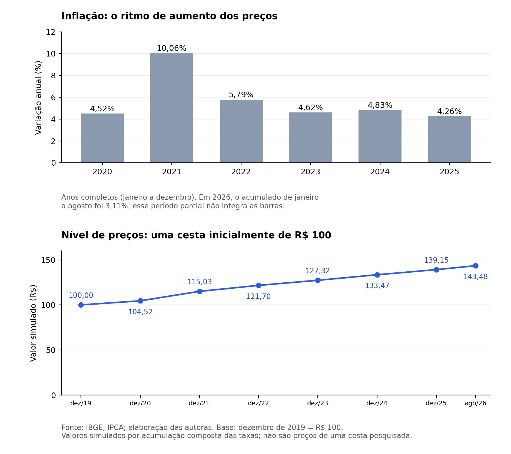

O consumidor chega ao supermercado, compra os mesmos produtos e a conta final continua alta, pesando no orçamento. No noticiário, porém, o resultado do IPCA (Índice Nacional de Preços ao Consumidor Amplo) de agosto de 2026 era negativo. A pergunta que surge é: “Se os preços caíram, por que a compra do mês continua cara?”. Para entender essa diferença, precisamos olhar para o que caiu, para as altas anteriores e para o que cada família consome.

A queda registrada em agosto veio, em boa parte, de um desconto temporário na conta de luz, associado ao bônus de Itaipu. O efeito desse desconto ficou concentrado naquele mês, e o IPCA voltou a subir em setembro. No entanto, uma queda pontual não é suficiente para compensar a alta acumulada ao longo dos anos. Para entender por que “inflação controlada” e “vida mais barata” não são a mesma coisa, é preciso separar três conceitos que costumam ser confundidos: nível de preços, inflação e deflação.

## Diferenciando conceitos

O nível de preços é o custo médio de uma cesta de consumo em determinado momento: quanto custa, hoje, manter o padrão de vida de uma família típica. A inflação é o aumento do nível geral de preços, que reduz o poder de compra do dinheiro. Quando o IBGE informou que a inflação acumulada em 12 meses havia sido de 4,22%, isso significava que a cesta estava, em média, 4,22% mais cara do que um ano antes. Já a deflação é o oposto da inflação: uma queda no nível geral de preços. Foi o caso de agosto de 2026, quando esse nível caiu 0,32%.

Quando a inflação cai de 10% para 4% ao ano, o ritmo de aumento dos preços diminui, mas eles continuam subindo. Esse movimento tem um nome técnico: desinflação. Foi o que ocorreu no Brasil nos anos seguintes ao pico de inflação registrado após a pandemia: a inflação recuou, mas os preços seguiram em alta. Para que o nível geral de preços diminua, é preciso haver deflação. Mesmo assim, um mês de deflação depois de anos de alta não faz com que os preços retornem ao patamar anterior.

## A conta que se acumula

O ponto central é que a inflação se acumula. Cada ano de alta parte do nível de preços deixado pelo ano anterior. Por isso, os percentuais não são simplesmente somados: eles se acumulam sobre valores que também mudam. Para ilustrar, imagine que uma compra que custava R\$ 100,00 em janeiro 2020 e que hoje custa R\$ 143,00. Nesse cenário hipotético, os preços aumentaram 43%, enquanto o poder de compra da mesma quantia em dinheiro diminuiu aproximadamente 30%. Isso acontece porque os mesmos R\$ 100,00 agora compram apenas cerca de 70% da cesta original.

{width="100%" style="margin: 20px 0;"} Uma pequena queda mensal dificilmente compensaria esse aumento acumulado. Se a compra de R\$ 143,48 ficasse 0,32% mais barata, passaria a custar aproximadamente R\$ 143,02. O consumidor teria algum alívio, mas continuaria pagando muito mais do que antes.

Por isso, a inflação na meta não devolve o que foi perdido, apenas indica que o ritmo de aumento dos preços está alinhado ao objetivo estabelecido.

::: caixinha-lateral-esq
**“Tá, mas e a economia?” — Meta de Inflação**

A meta de inflação é fixada pelo Conselho Monetário Nacional e perseguida pelo Banco Central por meio da política monetária. Desde 2025, corresponde a 3% para o IPCA acumulado em 12 meses, apurado mensalmente, com intervalo de tolerância de 1,5% a 4,5%. Uma inflação próxima da meta ajuda a dar previsibilidade às decisões econômicas e financeiras.
:::

Para saber se o salário permite comprar mais ou menos, é preciso observar sua evolução em relação aos preços. Se ele sobe menos que o custo da cesta consumida, a família perde poder de compra, mesmo com a inflação dentro da meta.

::: caixinha-lateral-dir
**“Tá, mas e a economia?” — Salário Real**

O salário nominal é o valor recebido em dinheiro. O salário real representa o que esse dinheiro permite comprar, considerando os preços vigentes. Se o salário aumenta 5%, mas os preços da cesta consumida sobem 6%, o reajuste não é suficiente para preservar o poder de compra. O valor recebido cresceu, mas permite comprar menos do que antes.
:::

## O que o IPCA representa?

O IPCA acompanha os preços de uma cesta média de produtos e serviços consumidos por famílias com renda de 1 a 40 salários mínimos, nas áreas urbanas abrangidas pela pesquisa. Cada item tem um peso proporcional à parcela que ocupa no orçamento dessas famílias médias. A composição tem como base a Pesquisa de Orçamentos Familiares (POF), que identifica como elas distribuem seus gastos. Entre as revisões dessa estrutura, os pesos percentuais são atualizados mensalmente conforme a evolução dos preços.

Essa cesta inclui alimentação, habitação, transportes, saúde, educação e outras despesas. Por isso, uma queda no índice geral não demonstra que todos os produtos da cesta ficaram mais baratos, isso porque uma redução na conta de luz pode compensar aumentos em outras despesas e puxar o resultado para baixo.

Quem gasta boa parte do orçamento com comida, por exemplo, sente mais as altas dos alimentos, que nos últimos anos subiram acima do índice geral. Em 2020, a alimentação no domicílio subiu cerca de 18%, quatro vezes a variação do índice geral.

O IBGE também calcula outros índices para acompanhar diferentes perfis de consumo. O INPC, por exemplo, considera famílias com renda de 1 a 5 salários mínimos, cujo orçamento é mais concentrado em gastos com alimentação e transporte.

::: caixinha-lateral-esq
**“Tá, mas e a economia?” — Como os pesos influenciam o IPCA?** Em uma cesta hipotética, alimentação pesa 40%, habitação 30% e transportes 30%. Se esses preços variarem, respectivamente, +1%, −2% e 0%, suas contribuições serão +0,40, −0,60 e zero ponto percentual. O índice da cesta será −0,20%: a queda da habitação supera a contribuição positiva da alimentação. Pesos e variações são hipotéticos.
:::

Quem sente mais a diferença de preços?

O IPCA representa a inflação de uma cesta média, mas cada um distribui seus gastos conforme suas necessidades. Por isso, a inflação percebida pode ser diferente daquela divulgada pelo resultado oficial.

Em 2022, por exemplo, o IPCA subiu 5,79%, enquanto a alimentação no domicílio aumentou 13,23% e os transportes caíram 1,29%. O contraste ajuda a entender por que o resultado médio pode se distanciar da experiência de quem faz as compras do mês. A tabela aplica essas variações a cestas que custavam R\$ 100,00 no início de 2022. Cada linha acompanha exclusivamente o índice ou componente indicado:

| Referência               | Variação em 2022 | Valor final da cesta |
|:-------------------------|:----------------:|---------------------:|
| IPCA geral               |      5,79%       |           R\$ 105,79 |
| Alimentação no domicílio |      13,23%      |           R\$ 113,23 |
| Transportes              |      −1,29%      |            R\$ 98,71 |

Fonte: IBGE, IPCA de dezembro de 2022. Valores em reais simulados pela aplicação da variação anual sobre R\$ 100,00; não representam preços de cestas pesquisadas.

Na prática, as famílias combinam produtos de diferentes grupos. Quem destina uma parcela maior do orçamento à alimentação no domicílio fica mais exposto às altas desse componente, mas sua inflação depende também dos demais gastos.

## Então seria melhor que os preços caíssem?

Diante disso, é natural imaginar que o ideal seria uma deflação prolongada, que trouxesse os preços de volta ao patamar antigo. A teoria econômica e a experiência histórica apontam o contrário. Quando os preços passam a cair de forma generalizada, consumidores e empresas tendem a adiar compras e investimentos à espera de preços ainda menores. Com isso, as vendas recuam, a produção e o emprego caem e a própria queda de preços pode se reforçar.

Há ainda um obstáculo prático: muitos preços resistem a cair, mesmo quando as condições da economia mudam. Assim, tentar reverter toda a alta acumulada por meio de uma redução generalizada dos preços poderia exigir uma forte contração da atividade econômica, com desemprego e queda de renda. É por isso que os bancos centrais buscam uma inflação baixa, estável e positiva, em vez de tentar fazer os preços voltarem ao patamar antigo.

::: caixinha-lateral-dir
**“Tá, mas e a economia?” — Rigidez de preços** Rigidez nominal de preços é a demora dos preços em se ajustar às mudanças de custos e de demanda. Contratos, reajustes em datas fixas e custos de remarcação ajudam a explicar essa demora. Por isso, alguns preços mudam rapidamente, enquanto outros permanecem meses com o mesmo valor.
:::

O caminho para recuperar o poder de compra, portanto, passa principalmente pelo crescimento da renda acima da inflação, sustentado por ganhos de produtividade. Para quem faz as compras do mês, o alívio se torna mais perceptível quando o salário permite levar para casa mais produtos, sem comprometer uma parcela cada vez maior do orçamento.

::: callout-tip
#### ODS 8 — Trabalho decente e crescimento econômico

A discussão sobre como a inflação afeta o poder de compra e as condições de vida das famílias, podemos conectar o tema a ODS 8. Ao explicar por que uma queda pontual dos preços não compensa as altas acumuladas, a produção contribui para o debate sobre crescimento econômico inclusivo e bem-estar dos trabalhadores.
:::

**Transparência em Uso de IA:** Ferramentas: ChatGPT e Claude. Utilizados para revisão ortográfica e gramatical, suporte na estruturação do texto e geração de gráficos. As autoras foram responsáveis pela escrita e revisão integral do conteúdo apresentado.

**Para saber mais:**

INSTITUTO BRASILEIRO DE GEOGRAFIA E ESTATÍSTICA (IBGE). Índice Nacional de Preços ao Consumidor Amplo – IPCA. Rio de Janeiro: IBGE, 2026. Disponível em:<https://www.ibge.gov.br/estatisticas/economicas/precos-e-custos/9256-indice-nacional-de-precos-ao-consumidor-amplo.html>. Acesso em: out. 2026.

INSTITUTO BRASILEIRO DE GEOGRAFIA E ESTATÍSTICA (IBGE). Índice Nacional de Preços ao Consumidor – INPC. Rio de Janeiro: IBGE, 2026. Disponível em:<https://www.ibge.gov.br/estatisticas/economicas/precos-e-custos/9258-indice-nacional-de-precos-ao-consumidor.html> . Acesso em: out. 2026.

BANCO CENTRAL DO BRASIL. Metas para a inflação. Brasília: BCB, 2026. Disponível em: <https://www.bcb.gov.br/controleinflacao/metainflacao>. Acesso em: out. 2026.

BANCO CENTRAL DO BRASIL. Relatório de Política Monetária. Brasília: BCB, 2026. Disponível em: <https://www.bcb.gov.br/publicacoes/rpm>. Acesso em: out. 2026.

INSTITUTO BRASILEIRO DE GEOGRAFIA E ESTATÍSTICA (IBGE). IPCA: variação mensal, acumulada no ano e peso mensal, segundo o índice geral e os grupos de produtos e serviços – Brasil, agosto 2026. Rio de Janeiro: IBGE, 2026. Sistema IBGE de Recuperação Automática – SIDRA. Disponível em: \<<https://sidra.ibge.gov.br/home/ipca/brasil>. Acesso em: out. 2026.

INSTITUTO BRASILEIRO DE GEOGRAFIA E ESTATÍSTICA (IBGE). IPCA vai a 0,62% em dezembro e fecha 2022 em 5,79%. Agência de Notícias IBGE, 10 jan. 2023. Disponível em: <https://agenciadenoticias.ibge.gov.br/agencia-sala-de-imprensa/2013-agencia-de-noticias/releases/36047-ipca-vai-a-0-62-em-dezembro-e-fecha-2022-em-5-79>. Acesso em: nov. 2026.

::: botoes-fim-de-pagina
[Voltar para a Newsletter](indexNe.qmd){.btn-voltar}

[Ler o próximo texto](Estilo17.qmd){.btn-proximo}
:::
