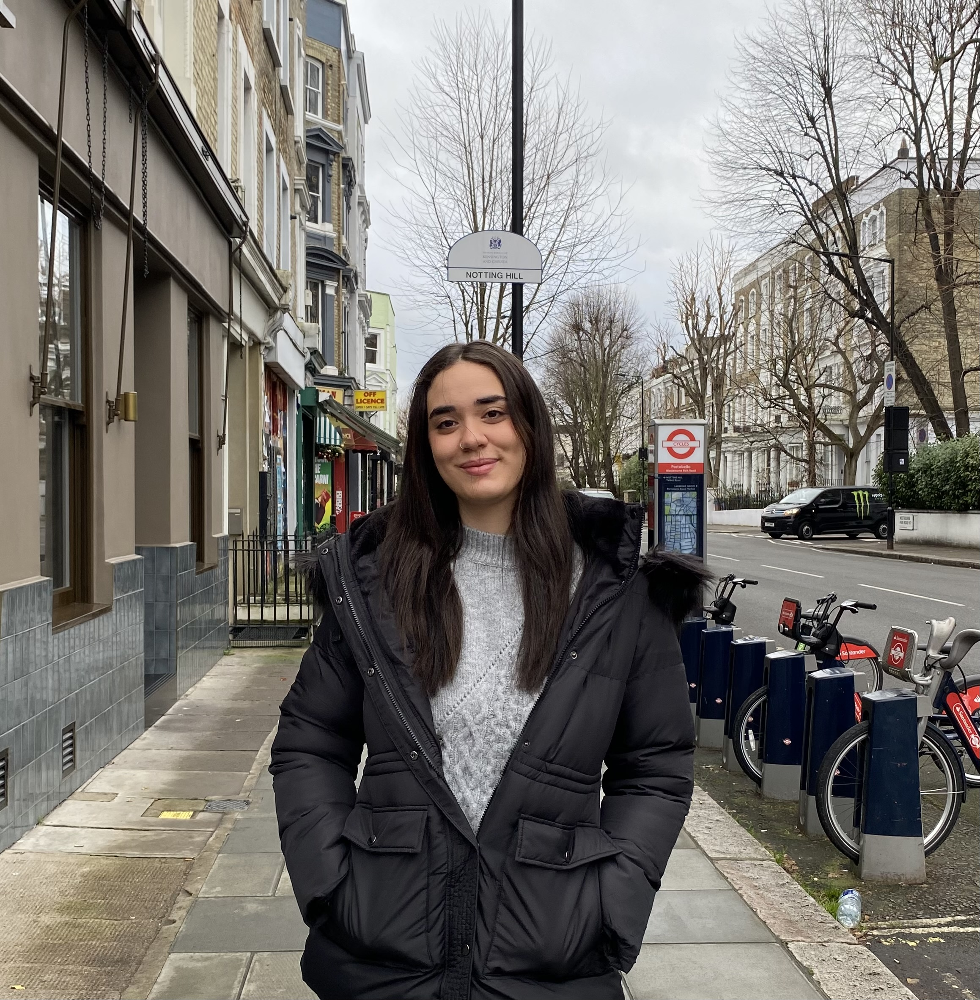
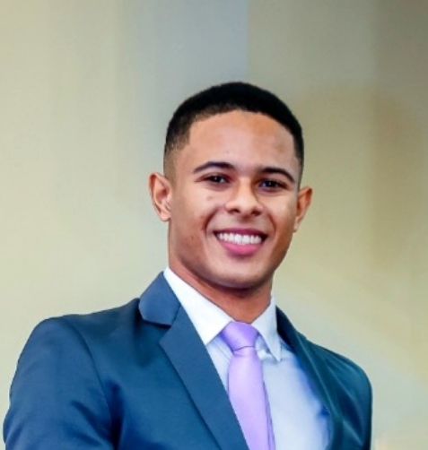
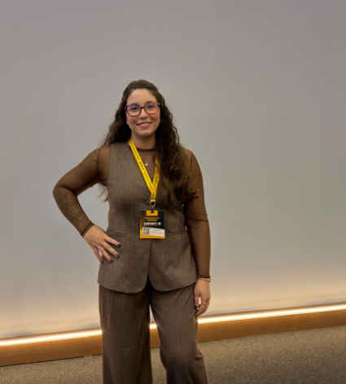
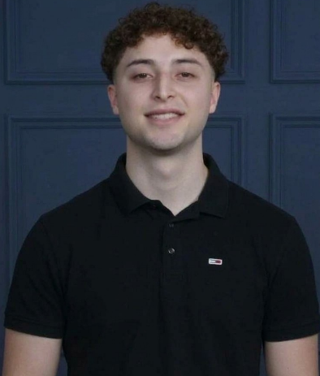
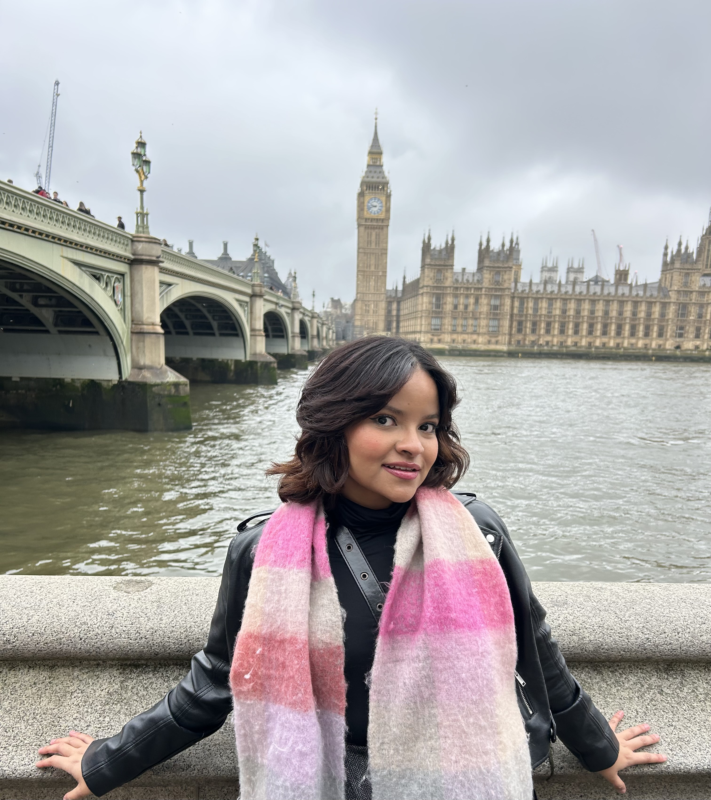
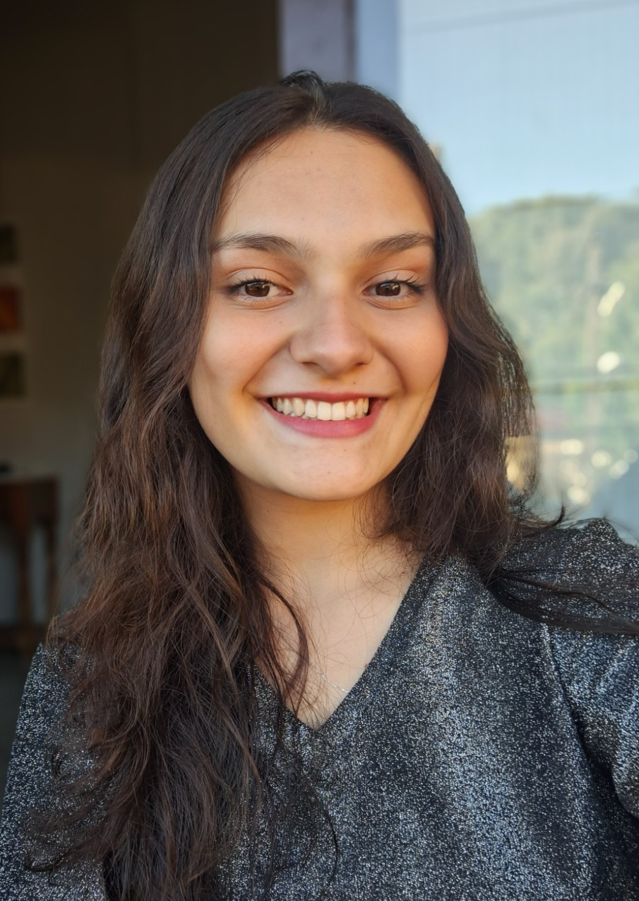
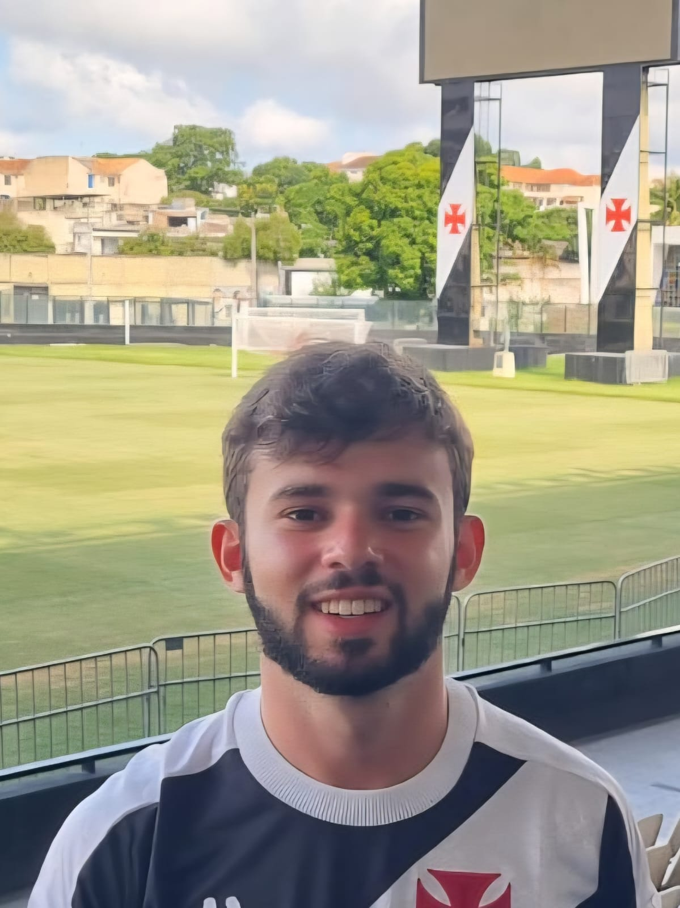
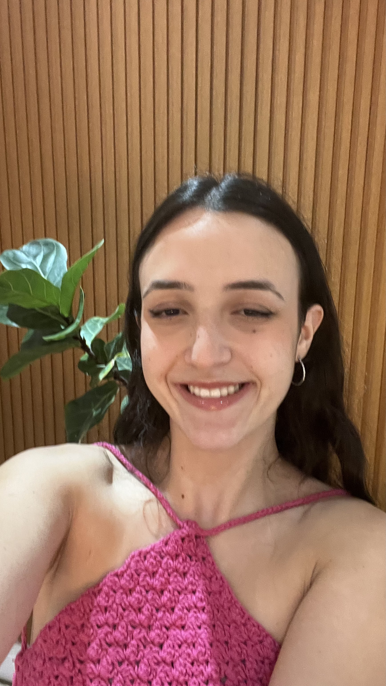
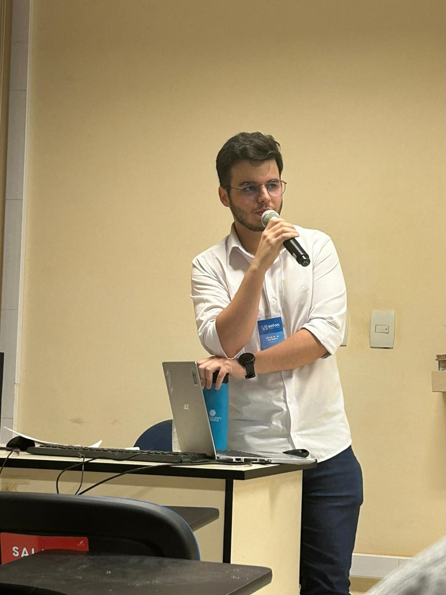
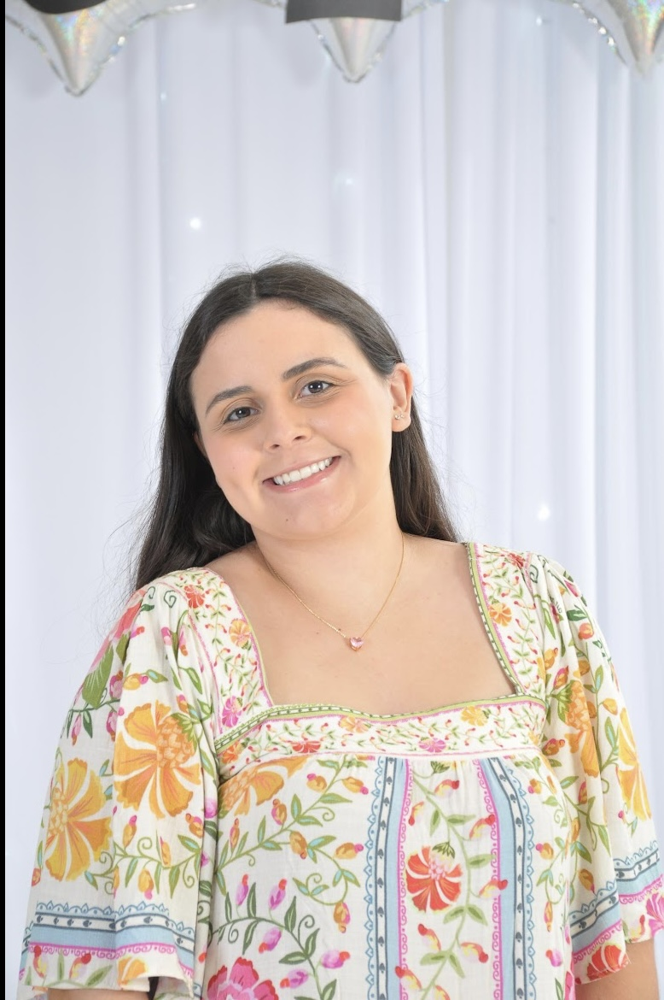

# Integrantes

Conheça a equipe por trás das análises e publicações do **Tá, mas e a economia?**. Nosso projeto é uma iniciativa de extensão universitária da Universidade de São Paulo (USP), desenvolvida no âmbito das **Atividades Extensionistas Curriculares (AEX)**, que buscam aproximar a Universidade da sociedade, levando o conhecimento acadêmico para além da sala de aula.

A cada ciclo, estudantes se organizam em diferentes frentes de trabalho para produzir e compartilhar conteúdos sobre economia. A equipe de produção é formada por oito estudantes das áreas de Economia ou Finanças e Negócios, responsáveis pela pesquisa, elaboração e escrita dos artigos que compõem nossas publicações.

Já a equipe de editoração e comunicação reúne estudantes de diferentes cursos da USP, não se restringindo às áreas de Economia ou Negócios. Seus integrantes cuidam da revisão, organização editorial, identidade visual, diagramação, divulgação e atualização dos canais de comunicação do projeto, contribuindo para que o conteúdo chegue ao público de maneira clara, acessível e atrativa.

Como uma iniciativa de caráter dinâmico e colaborativo, nossa equipe se renova a cada ciclo, incorporando novos estudantes e perspectivas. Abaixo, você pode conhecer os colaboradores que fazem parte do projeto neste período e nos anteriores.

## Turma 3 - Turma atual

Segundo semestre de 2026

Equipe de produção

### Patricia Lutaif

Economia · FEA-RP/USP

Possuo interesse principalmente em macroeconomia, crescimento econômico e economia do setor público. Atualmente realizo iniciação científica nas áreas de história econômica e economia internacional, a respeito do fluxo do comércio paulista. Também participei da Entidade Estudantil Neuron, com foco em ciência de dados.

### Luiz Gustavo Neri

Economia · FEA-RP/USP

Tenho interesse especialmente na área de macroeconomia, organização industrial e finanças internacionais. Fui diretor na Associação Atlética Acadêmica Flaviana Condeixa Favaretto, também atuei na área de eventos e no grupo de estudos da entidade estudantil Agrocare.

### Benedito Moreno Nogueira Junior

Economia · FEA-RP/USP

Possuo interesse no setor público, na área acadêmica e em jornalismo econômico. Sou bolsista FAPESP, pesquisando na área de custos no Centro Multidisciplinar de Estratégia, Pesquisa e Inovação (CeMEPI). Participo como Trainee de Programas Sociais no Clube Afirmativo de Negócios (CAN). Gosto de matérias como Macroeconomia e História Econômica.

### Luiz Henrique Alves do Nascimento

Economia · FEA-RP/USP

Tenho interesse nos temas de macroeconometria e avaliação de políticas públicas. Participei da Entidade Estudantil Neuron DS&AI como Diretor da área de Quant e desenvolvi uma iniciação científica na área de dados jurídicos pelo grupo de pesquisa Habeas Data, e hoje atuo profissionalmente no setor de precificação.

### Ana Clara Bortolon Belmonte

Finanças e Negócios · FEA-RP/USP

Tenho interesse em mercado financeiro, finanças comportamentais e economia internacional, especialmente câmbio e diversificação de portfólio. Faço parte da Atlética da FEA-RP e já participei do Núcleo de Empreendedores.

### Marcela Marques

Finanças e Negócios · FEA-RP/USP

Tenho interesse pelo mercado financeiro, especialmente por avaliação de empresas e modelagem financeira. Também me interesso por contabilidade financeira e comportamental, principalmente para entender como isso influencia na tomada de decisões financeiras. Já fui membro da área de Data Analytics na Neuron DS&AI.

### Raphaela Minhoto Cunha

Finanças e Negócios · FEA-RP/USP

Apaixonada por finanças, empreendedorismo e comunicação, busca conectar conhecimento acadêmico com experiências práticas e projetos que gerem impacto. Atualmente, atua na Diretoria de Marketing do Núcleo de Empreendedores da FEA-RP/USP e acredita que a universidade é um espaço para transformar ideias em oportunidades.

### João Pedro Amaral Araujo

Economia · FEA-RP/USP

Tenho interesse principalmente na área de Política Fiscal, Ciclos Econômicos e Finanças. Fiz parte da Gestão de Pessoas do Clube de Mercado Financeiro (CMF), assim como fui membro da Atlética. Gosto da USP por ter uma comunidade de pessoas que pensam além do comum.

Equipe de comunicação e edição

### Paula Leandra de Oliveira

Economia · FEA-RP/USP

Afinidade com a macroeconomia e os impactos sociais da economia de forma ampla. Além disso, também me interesso por analise de dados e programação.

### Isabela Maísa Gardini

Administração · FEA-RP/USP

Tenho interesse por gestão, finanças e desenvolvimento de pessoas. Dentro da FEA, já participei da Empresa Júnior e do Clube de Mercado Financeiro. Além disso, faço parte do LEO Clube, um clube de serviço social jovem, o qual me fez perceber o meu gosto por transformar ideias em projetos e responsável pela minha escolha profissional.

### Ester Maria do Nascimento

Jornalismo · ECA/USP

Tenho interesse em jornalismo econômico e direitos humanos. Realizei uma pesquisa sobre as iniciativas midiáticas dos territórios periféricos de São Paulo e possuo experiência em comunicação na Agência Pública, no Instituto Socioambiental e, atualmente, no Desenrola e Não Me Enrola.

### Luise Homobono

Jornalismo · ECA/USP

Tenho interesse por economia, relações internacionais e política, afinal tudo está ligado um ao outro. Já fui freelancer no E-Investidor do Estadão e atualmente trabalho na CNN Brasil na editoria Nacional e sou editora de áudio no podcast “Diversidade em Ciência”, da rádio USP.

## Turma 2

Primeiro semestre de 2026

Equipe de produção

### Sofia de Almeida Rodrigues

Economia · FEA-RP/USP

Interesse em macroeconomia e finanças corporativas, e afinidade com análises que articulam dados e impactos sociais.

### Giovana Alves Paiva

Economia · FEA-RP/USP

Interesse na dimensão social da economia e em políticas públicas, com foco em desigualdade e acesso a oportunidades.

### Luiz Henrique Braga Scorzafave

Economia · FEA-RP/USP

Interesse na área de economia política e políticas públicas.

### Pedro Konstantino Freire Voltezou

Economia · FEA-RP/USP

Interesse em macroeconomia, história econômica, economia política e finanças.

### Arthur Coelho Oliveira

Economia · FEA-RP/USP

Interesse em macroeconomia, economia política e finanças corporativas.

### Maria Carolina Dias Lobato

Economia · FEA-RP/USP

Interesse em macroeconomia, políticas públicas e economia internacional.

### Beatriz Poncio

Economia · FEA-RP/USP

Interesse em macroeconomia, economia política e economia internacional.

### Rafael Sanches

Finanças e Negócios · FEA-RP/USP

Interesse em governança corporativa, macroeconomia e finanças.

Equipe de comunicação e edição

### Isabella Gargano

Jornalismo · ECA/USP

Afinidade com jornalismo econômico e político internacional.

### Thaís Ferreira Cruz

Química forense · FFCLRP/USP

Afinidade com a área de toxicologia bioquímica.

### Samuel Rubens

Ciência da Computação · ICMC/USP

Atuou como engenheiro de software por 5 anos e atualmente está empreendendo com a Rubrion.

### Ryan

Administração · FEA-RP/USP

Interesse na área de marketing. Atua como estagiário na Assessoria de Comunicação da faculdade.

## Turma 1

Segundo semestre de 2025

Equipe de produção

### Anna Livya Queiroz

Economia · FEA-RP/USP

### Caroline Lhais Oliveira

Economia · FEA-RP/USP

### Gustavo Lima Moraes

Economia · FEA-RP/USP

### João Gabriel

Economia · FEA-RP/USP

### Manuela Marangoni Jampani

Economia · FEA-RP/USP

### Matheus de Souza Teixeira

Economia · FEA-RP/USP

### Paula Leandra

Economia · FEA-RP/USP

### Jonathan Cunha

Economia · FEA-RP/USP

Equipe de comunicação e edição

### Leticia Brito

Administração · FEA-RP/USP

### Giuliana Sigilló

Educação Física · EEFERP/USP

### Bruna Agostini

Administração · FEA-RP/USP

### Gabriel

Administração · FEA-RP/USP

Professora responsável

### Roseli Basso-Silva

Professora responsável

Professora de economia, economista de formação, propôs esta Atividade de Extensão "AEX — Tá, mas e a economia?" a partir da iniciativa da estudante Carol Lhais para, juntas e juntos, contribuirmos para o debate econômico no país, para além dos muros da USP.
