```{=html}
<div class="pagina-equipe">

  <h1 class="equipe-turma" style="margin-top: 1.5rem;">Integrantes</h1>
  <p class="equipe-turma-sub">Quem faz a newsletter, edição após edição.</p>

  <p class="equipe-intro">Conheça a equipe por trás das análises e publicações deste semestre. Nosso projeto faz parte das <strong>Atividades Extensionistas Curriculares (AEX)</strong>, o que significa que nosso time é dinâmico e rotativo. A cada novo ciclo, novos estudantes assumem o desafio de levar o conhecimento acadêmico para a sociedade. Estes são os colaboradores que compõem o projeto no período atual.</p>

<h2 class="equipe-turma">Turma 3</h2>
  <p class="equipe-turma-sub">Segundo semestre de 2026</p>


  <div class="equipe-secao">Equipe de produção</div>

  <div class="equipe-grade">
    <div class="cartao-membro">
      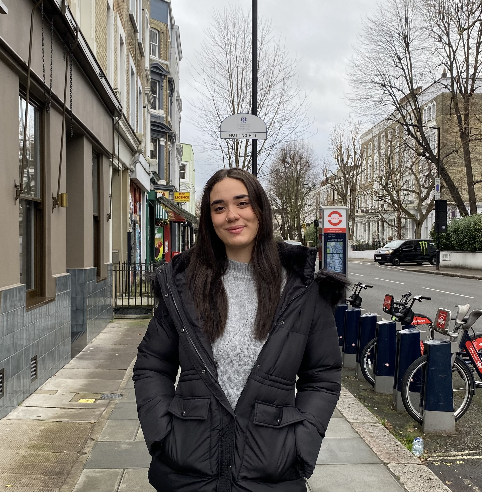
      <h3 class="membro-nome">Patricia Lutaif</h3>
      <p class="membro-curso">Economia · FEA-RP/USP</p>
      <p class="membro-bio">Possuo interesse principalmente em macroeconomia, crescimento econômico e economia do setor público. Atualmente realizo iniciação científica nas áreas de história econômica e economia internacional, a respeito do fluxo do comércio paulista. Também participei da Entidade Estudantil Neuron, com foco em ciência de dados.</p>
    </div>

<div class="cartao-membro">
      
      <h3 class="membro-nome">Luiz Gustavo Neri</h3>
      <p class="membro-curso">Economia · FEA-RP/USP</p>
      <p class="membro-bio">Tenho interesse especialmente na área de macroeconomia, organização industrial e finanças internacionais. Fui diretor na Associação Atlética Acadêmica Flaviana Condeixa Favaretto, também atuei na área de eventos e no grupo de estudos da entidade estudantil Agrocare.
</p>
    </div>

<div class="cartao-membro">
      
      <h3 class="membro-nome">Benedito Moreno Nogueira Junior</h3>
      <p class="membro-curso">Economia · FEA-RP/USP</p>
      <p class="membro-bio">Possuo interesse no setor público, na área acadêmica e em jornalismo econômico. Sou bolsista FAPESP, pesquisando na área de custos no Centro Multidisciplinar de Estratégia, Pesquisa e Inovação (CeMEPI). Participo como Trainee de Programas Sociais no Clube Afirmativo de Negócios (CAN). Gosto de matérias como Macroeconomia e História Econômica. </p>
    </div>

<div class="cartao-membro">
      
      <h3 class="membro-nome">Luiz Henrique Alves do Nascimento</h3>
      <p class="membro-curso">Economia · FEA-RP/USP</p>
      <p class="membro-bio">Tenho interesse nos temas de macroeconometria e avaliação de políticas públicas. Participei da Entidade Estudantil Neuron DS&AI como Diretor da área de Quant e desenvolvi uma iniciação científica na área de dados jurídicos pelo grupo de pesquisa Habeas Data, e hoje atuo profissionalmente no setor de precificação.</p>
    </div>
    
<div class="cartao-membro">
      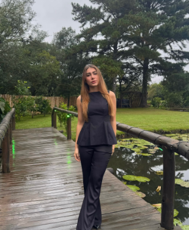
      <h3 class="membro-nome">Ana Clara Bortolon Belmonte</h3>
      <p class="membro-curso">Finanças e Negócios · FEA-RP/USP</p>
      <p class="membro-bio">Tenho interesse em mercado financeiro, finanças comportamentais e economia internacional, especialmente câmbio e diversificação de portfólio. Faço parte da Atlética da FEA-RP e já participei do Núcleo de Empreendedores.</p>
    </div>
    
<div class="cartao-membro">
      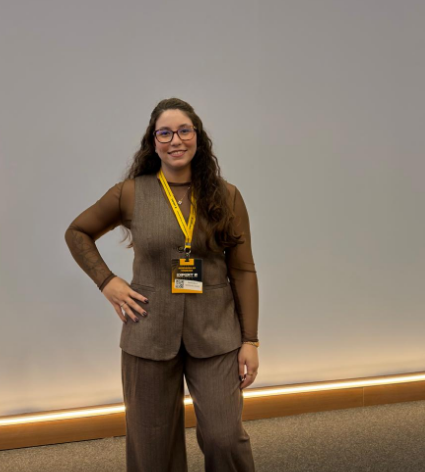
      <h3 class="membro-nome">Marcela Marques</h3>
      <p class="membro-curso">Finanças e Negócios · FEA-RP/USP</p>
      <p class="membro-bio">Tenho interesse pelo mercado financeiro, especialmente por avaliação de empresas e modelagem financeira. Também me interesso por contabilidade financeira e comportamental, principalmente para entender como isso influencia na tomada de decisões financeiras. Já fui membro da área de Data Analytics na Neuron DS&AI.</p>
    </div>
    
<div class="cartao-membro">
      
      <h3 class="membro-nome">Raphaela Minhoto Cunha</h3>
      <p class="membro-curso">Finanças e Negócios · FEA-RP/USP</p>
      <p class="membro-bio">Apaixonada por finanças, empreendedorismo e comunicação, busca conectar conhecimento acadêmico com experiências práticas e projetos que gerem impacto. Atualmente, atua na Diretoria de Marketing do Núcleo de Empreendedores da FEA-RP/USP e acredita que a universidade é um espaço para transformar ideias em oportunidades.</p>
    </div>
    
<div class="cartao-membro">
      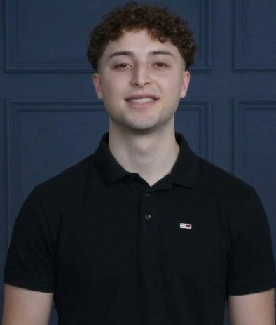
      <h3 class="membro-nome">João Pedro Amaral Araujo</h3>
      <p class="membro-curso">Economia · FEA-RP/USP</p>
      <p class="membro-bio">Tenho interesse principalmente na área de Política Fiscal, Ciclos Econômicos e Finanças. Fiz parte da Gestão de Pessoas do Clube de Mercado Financeiro (CMF), assim como fui membro da Atlética. Gosto da USP por ter uma comunidade de pessoas que pensam além do comum. </p>
    </div>
  </div>  

<div class="equipe-secao">Equipe de comunicação e edição</div>

  <div class="equipe-grade">
    <div class="cartao-membro">
      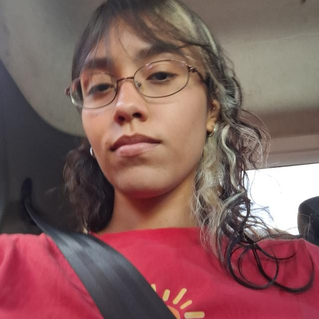
      <h3 class="membro-nome">Paula Leandra de Oliveira</h3>
      <p class="membro-curso"> Economia · FEA-RP/USP</p>
      <p class="membro-bio">Afinidade com a macroeconomia e os impactos sociais da economia de forma ampla. Além disso, também me interesso por analise de dados e programação.</p>
    </div>
    
<div class="cartao-membro">
      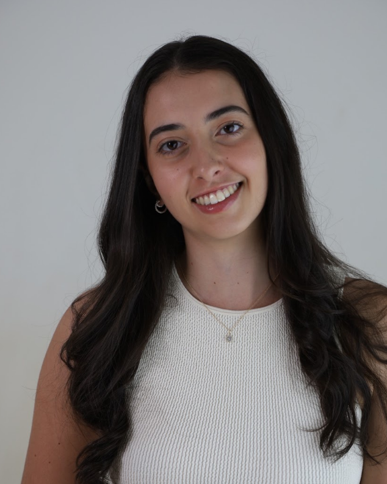
      <h3 class="membro-nome">Isabela Maísa Gardini</h3>
      <p class="membro-curso">Administração · FEA-RP/USP</p>
      <p class="membro-bio">Tenho interesse por gestão, finanças e desenvolvimento de pessoas. Dentro da FEA, já participei da Empresa Júnior e do Clube de Mercado Financeiro. Além disso, faço parte do LEO Clube, um clube de serviço social jovem, o qual me fez perceber o meu gosto por transformar ideias em projetos e responsável pela minha escolha profissional.</p>
    </div>
    
<div class="cartao-membro">
      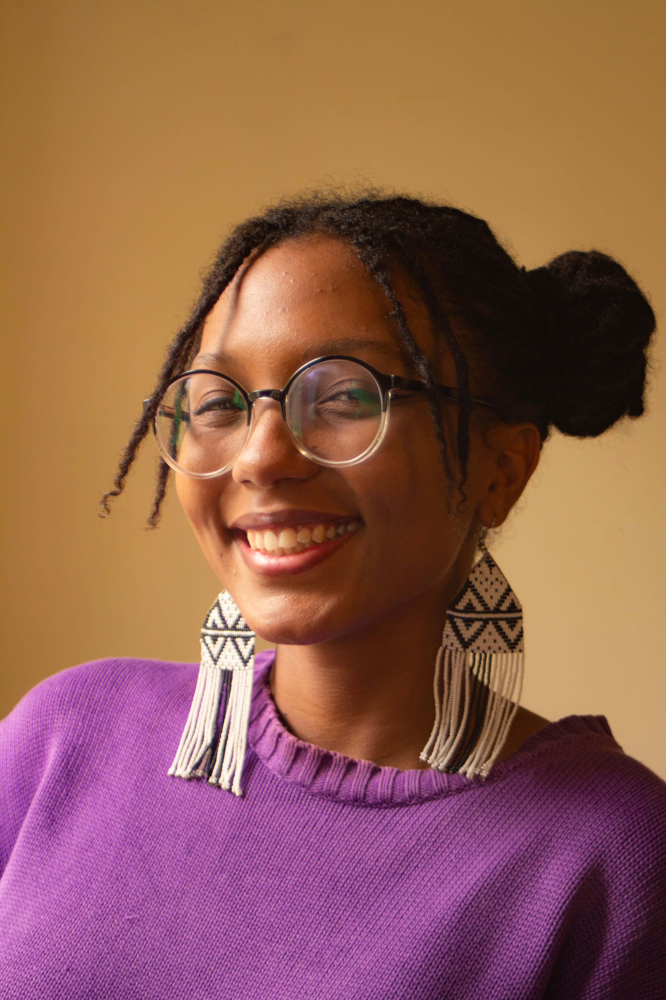
      <h3 class="membro-nome">Ester Maria do Nascimento</h3>
      <p class="membro-curso">Jornalismo · ECA/USP</p>
      <p class="membro-bio">Tenho interesse em jornalismo econômico e direitos humanos. Realizei uma pesquisa sobre as iniciativas midiáticas dos territórios periféricos de São Paulo e possuo experiência em comunicação na Agência Pública, no Instituto Socioambiental e, atualmente, no Desenrola e Não Me Enrola. </p>
    </div>
    
<div class="cartao-membro">
      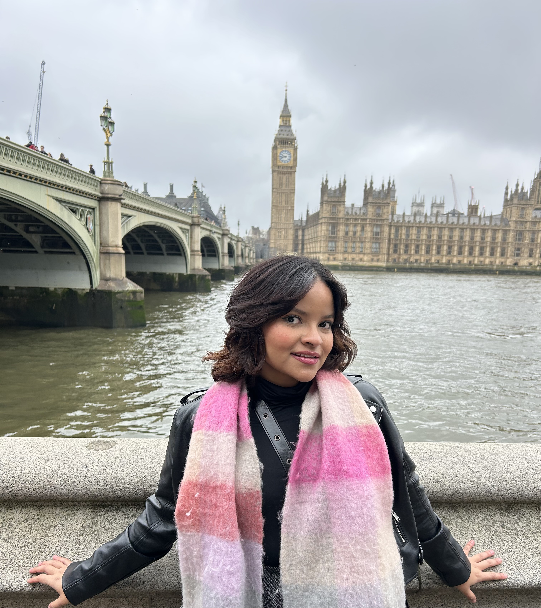
      <h3 class="membro-nome">Luise Homobono</h3>
      <p class="membro-curso">Jornalismo · ECA/USP</p>
      <p class="membro-bio">Tenho interesse por economia, relações internacionais e política, afinal tudo está ligado um ao outro. Já fui freelancer no E-Investidor do Estadão e atualmente trabalho na CNN Brasil na editoria Nacional e sou editora de áudio no podcast “Diversidade em Ciência”, da rádio USP. </p>
    </div>
  </div>


  <h2 class="equipe-turma">Turma 2</h2>
  <p class="equipe-turma-sub">Primeiro semestre de 2026</p>


  <div class="equipe-secao">Equipe de produção</div>

  <div class="equipe-grade">
    <div class="cartao-membro">
      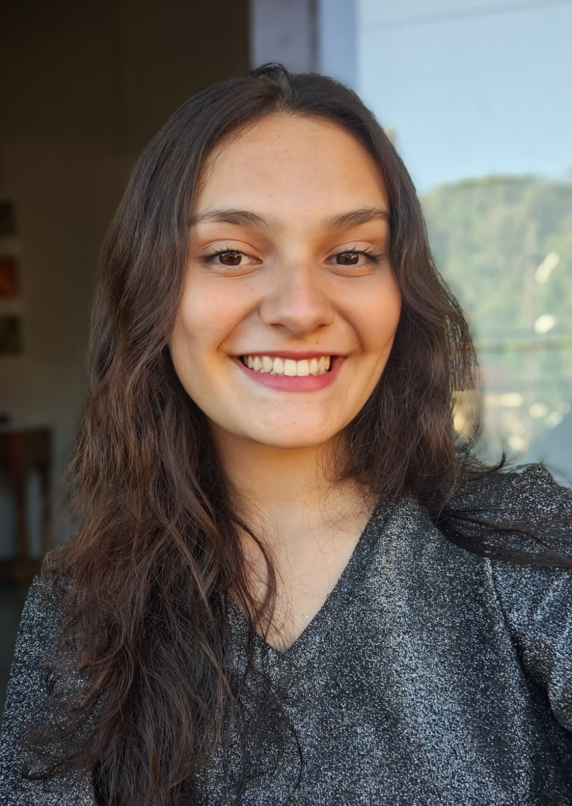
      <h3 class="membro-nome">Sofia de Almeida Rodrigues</h3>
      <p class="membro-curso">Economia · FEA-RP/USP</p>
      <p class="membro-bio">Interesse em macroeconomia e finanças corporativas, e afinidade com análises que articulam dados e impactos sociais.</p>
    </div>

    <div class="cartao-membro">
      
      <h3 class="membro-nome">Giovana Alves Paiva</h3>
      <p class="membro-curso">Economia · FEA-RP/USP</p>
      <p class="membro-bio">Interesse na dimensão social da economia e em políticas públicas, com foco em desigualdade e acesso a oportunidades.</p>
    </div>

    <div class="cartao-membro">
      
      <h3 class="membro-nome">Luiz Henrique Braga Scorzafave</h3>
      <p class="membro-curso">Economia · FEA-RP/USP</p>
      <p class="membro-bio">Interesse na área de economia política e políticas públicas.</p>
    </div>

    <div class="cartao-membro">
      
      <h3 class="membro-nome">Pedro Konstantino Freire Voltezou</h3>
      <p class="membro-curso">Economia · FEA-RP/USP</p>
      <p class="membro-bio">Interesse em macroeconomia, história econômica, economia política e finanças.</p>
    </div>

    <div class="cartao-membro">
      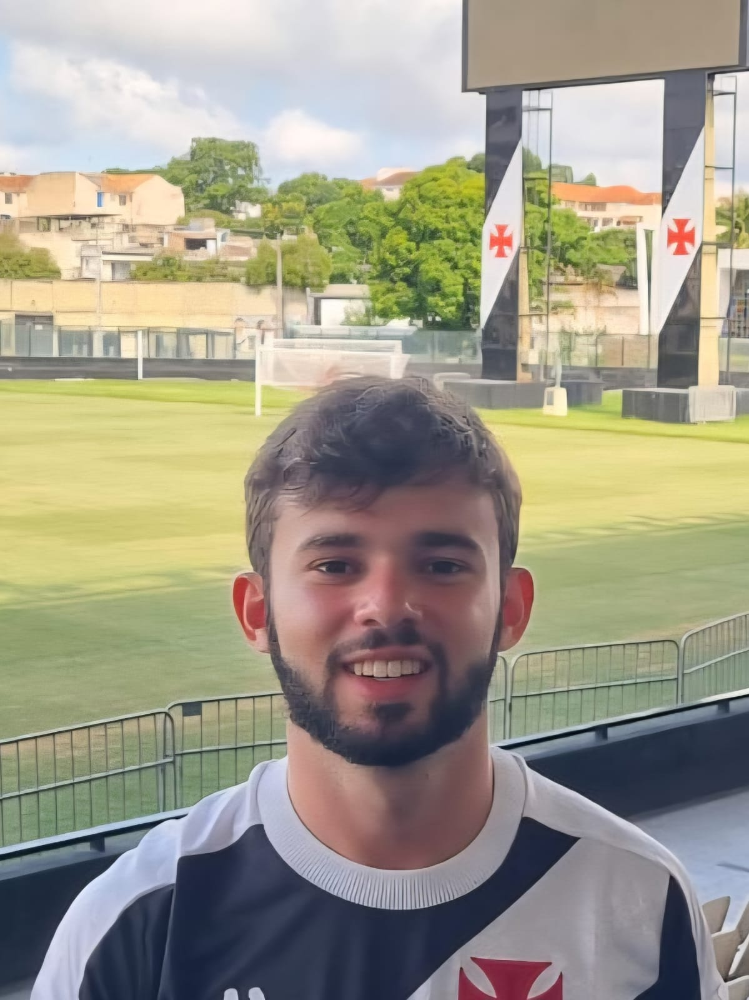
      <h3 class="membro-nome">Arthur Coelho Oliveira</h3>
      <p class="membro-curso">Economia · FEA-RP/USP</p>
      <p class="membro-bio">Interesse em macroeconomia, economia política e finanças corporativas.</p>
    </div>

    <div class="cartao-membro">
      
      <h3 class="membro-nome">Maria Carolina Dias Lobato</h3>
      <p class="membro-curso">Economia · FEA-RP/USP</p>
      <p class="membro-bio">Interesse em macroeconomia, políticas públicas e economia internacional.</p>
    </div>

    <div class="cartao-membro">
      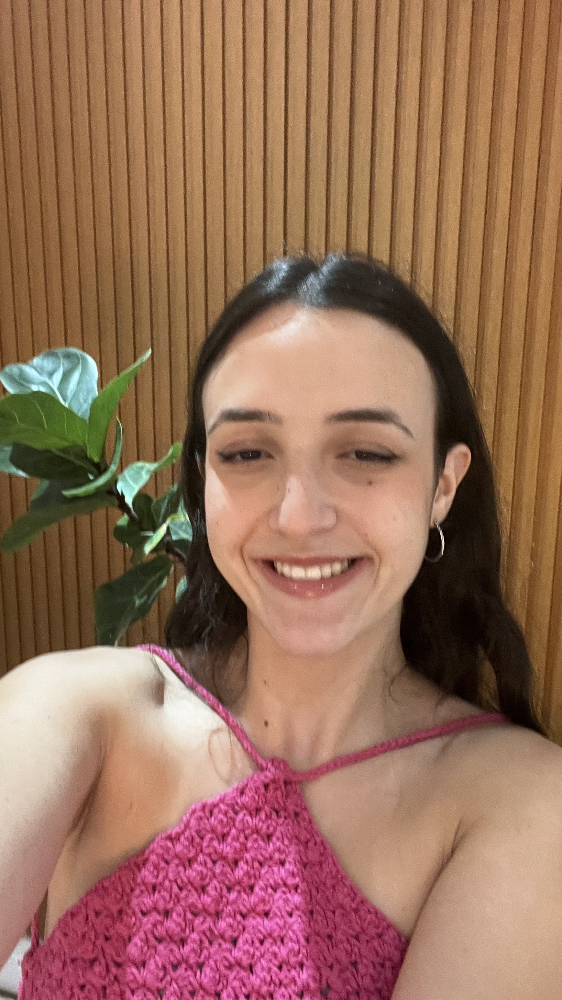
      <h3 class="membro-nome">Beatriz Poncio</h3>
      <p class="membro-curso">Economia · FEA-RP/USP</p>
      <p class="membro-bio">Interesse em macroeconomia, economia política e economia internacional.</p>
    </div>

    <div class="cartao-membro">
      
      <h3 class="membro-nome">Rafael Sanches</h3>
      <p class="membro-curso">Finanças e Negócios · FEA-RP/USP</p>
      <p class="membro-bio">Interesse em governança corporativa, macroeconomia e finanças.</p>
    </div>
  </div>

  <div class="equipe-secao">Equipe de comunicação e edição</div>

  <div class="equipe-grade">
    <div class="cartao-membro">
      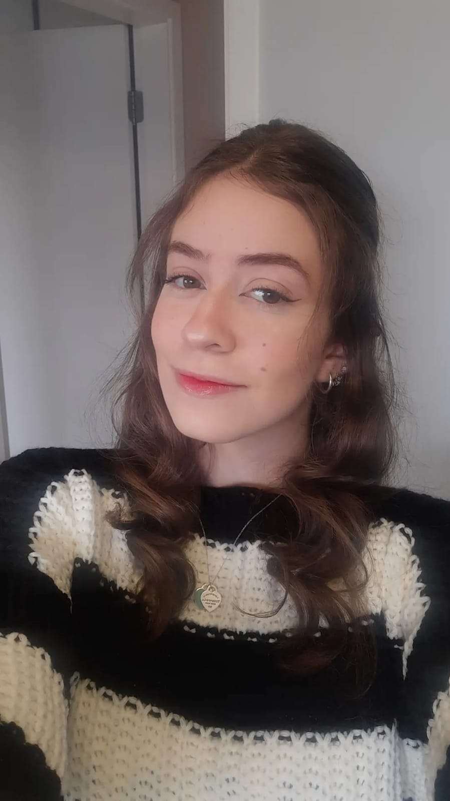
      <h3 class="membro-nome">Isabella Gargano</h3>
      <p class="membro-curso">Jornalismo · ECA/USP</p>
      <p class="membro-bio">Afinidade com jornalismo econômico e político internacional.</p>
    </div>

    <div class="cartao-membro">
      
      <h3 class="membro-nome">Thaís Ferreira Cruz</h3>
      <p class="membro-curso">Química forense · FFCLRP/USP</p>
      <p class="membro-bio">Afinidade com a área de toxicologia bioquímica.</p>
    </div>

    <div class="cartao-membro">
      
      <h3 class="membro-nome">Samuel Rubens</h3>
      <p class="membro-curso">Ciência da Computação · ICMC/USP</p>
      <p class="membro-bio">Atuou como engenheiro de software por 5 anos e atualmente está empreendendo com a Rubrion.</p>
    </div>

    <div class="cartao-membro">
      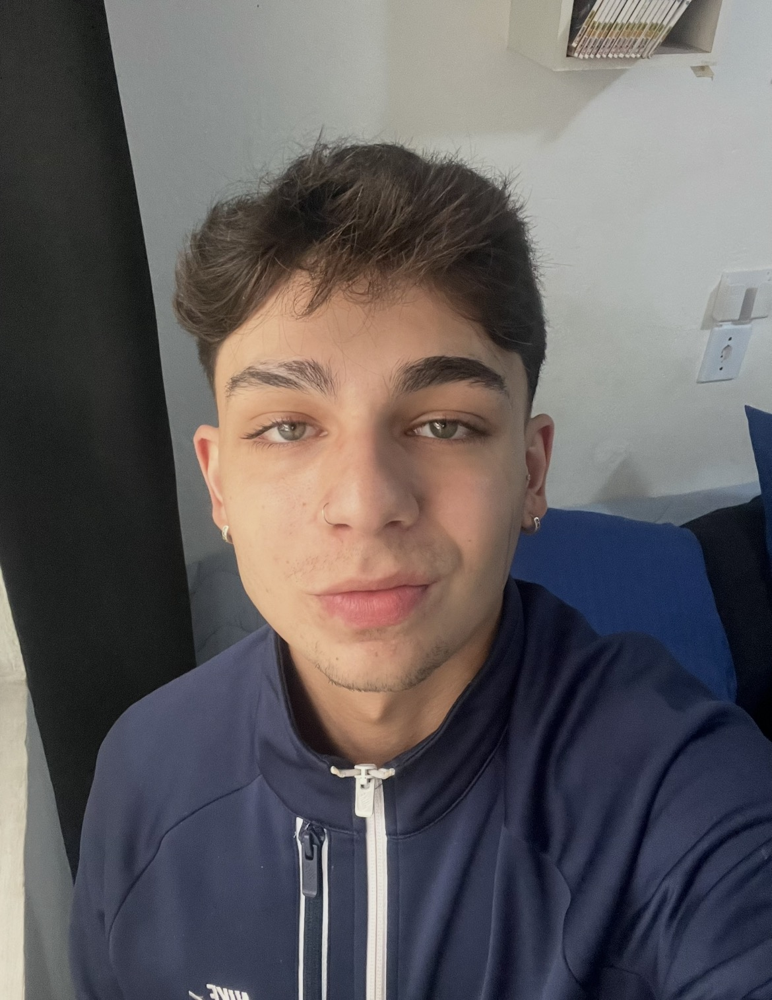
      <h3 class="membro-nome">Ryan</h3>
      <p class="membro-curso">Administração · FEA-RP/USP</p>
      <p class="membro-bio">Interesse na área de marketing. Atua como estagiário na Assessoria de Comunicação da faculdade.</p>
    </div>
  </div>

  <h2 class="equipe-turma">Turma 1</h2>
  <p class="equipe-turma-sub">Segundo semestre de 2025</p>

  <div class="equipe-grade equipe-grade-compacta">
    <div class="cartao-membro">
      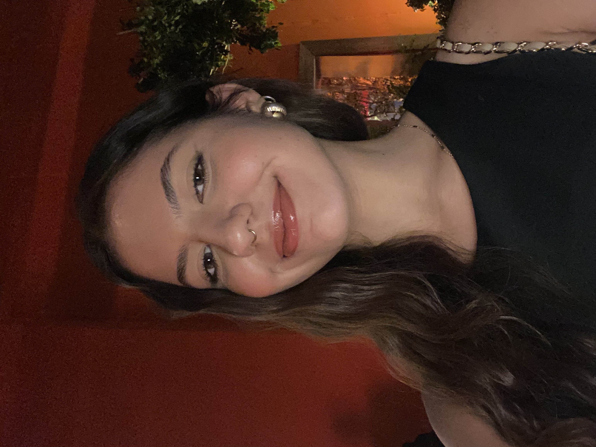
      <h3 class="membro-nome">Anna Livya Queiroz</h3>
    </div>
    <div class="cartao-membro">
      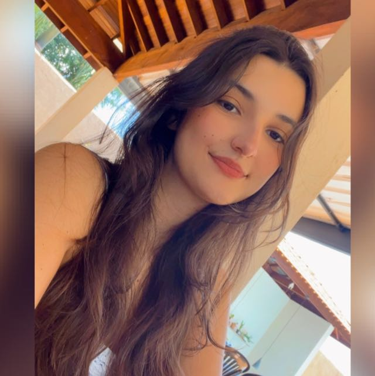
      <h3 class="membro-nome">Bruna Agostini</h3>
    </div>
    <div class="cartao-membro">
      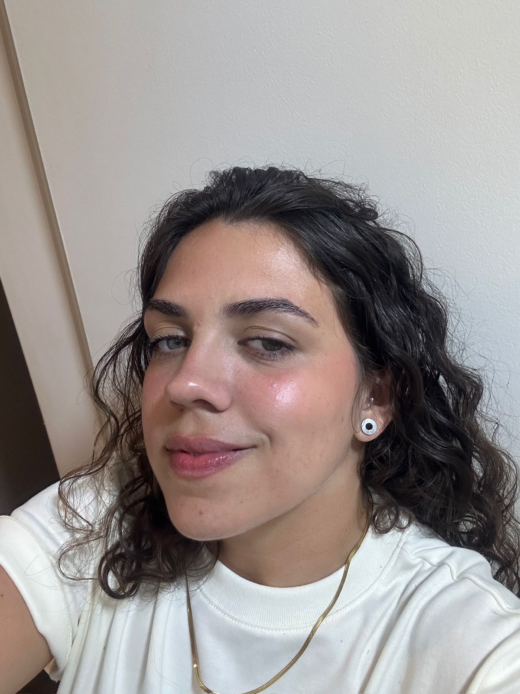
      <h3 class="membro-nome">Caroline Lhais Oliveira</h3>
    </div>
    <div class="cartao-membro">
      
      <h3 class="membro-nome">Gabriel</h3>
    </div>
    <div class="cartao-membro">
      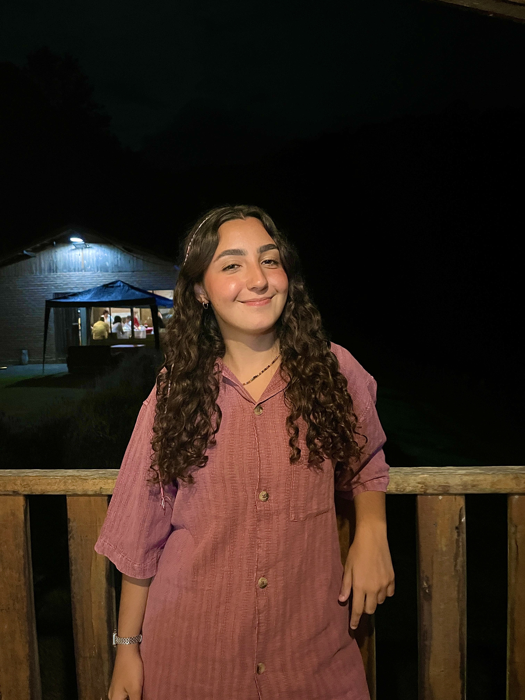
      <h3 class="membro-nome">Giuliana Sigilló</h3>
    </div>
    <div class="cartao-membro">
      
      <h3 class="membro-nome">Gustavo Lima Moraes</h3>
    </div>
    <div class="cartao-membro">
      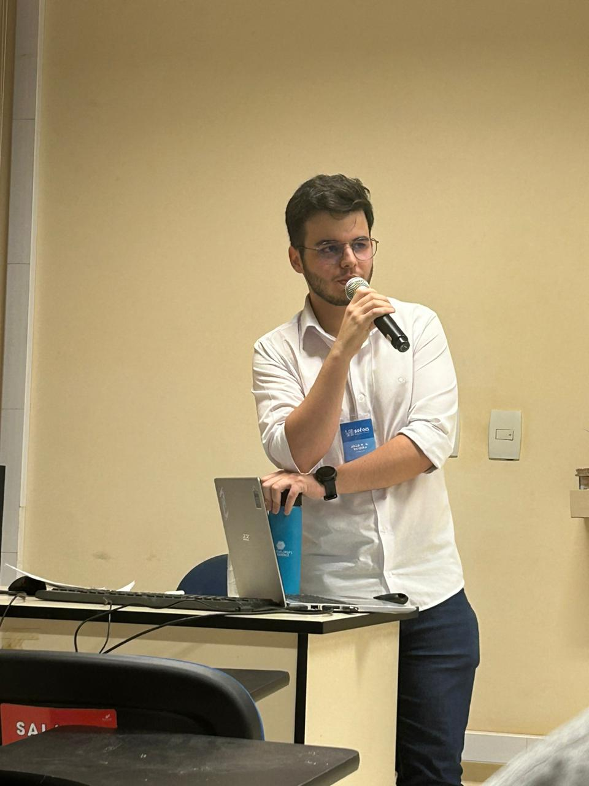
      <h3 class="membro-nome">João Gabriel</h3>
    </div>
    <div class="cartao-membro">
      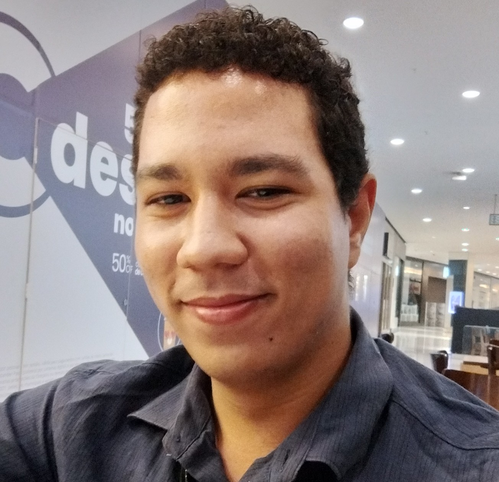
      <h3 class="membro-nome">Jonathan Cunha</h3>
    </div>
    <div class="cartao-membro">
      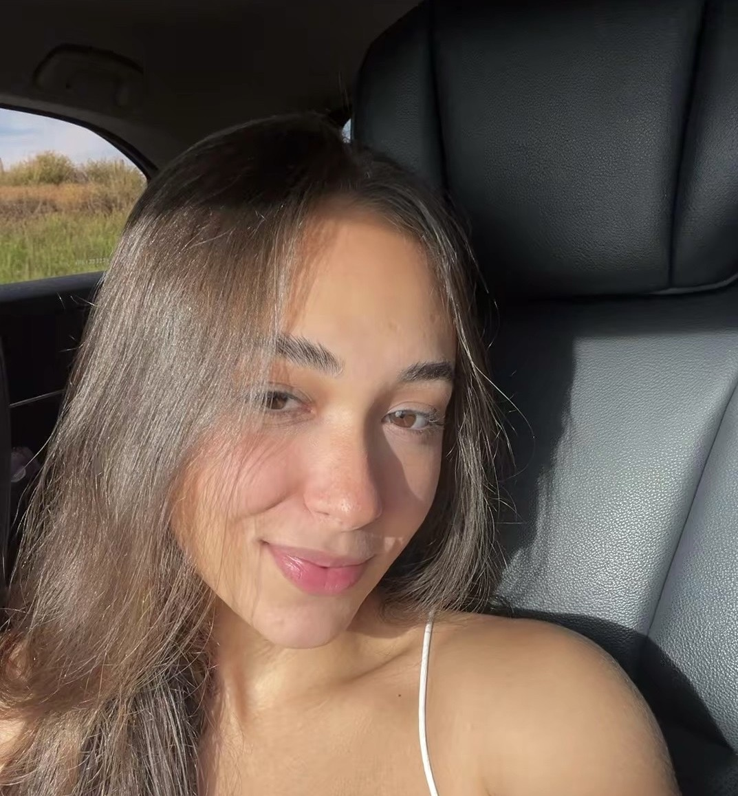
      <h3 class="membro-nome">Leticia Brito</h3>
    </div>
    <div class="cartao-membro">
      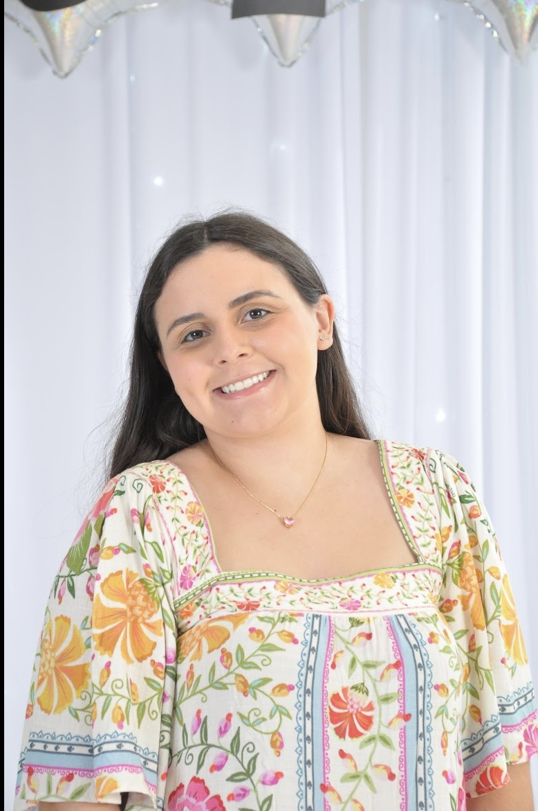
      <h3 class="membro-nome">Manuela Marangoni Jampani</h3>
    </div>
    <div class="cartao-membro">
      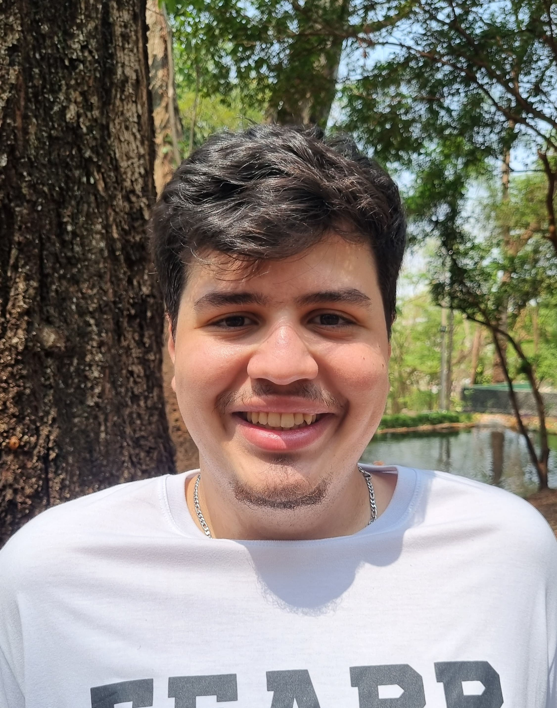
      <h3 class="membro-nome">Matheus de Souza Teixeira</h3>
    </div>
    <div class="cartao-membro">
      
      <h3 class="membro-nome">Paula Leandra</h3>
    </div>
  </div>


  <div class="equipe-secao">Professora responsável</div>

  <div class="equipe-grade">
    <div class="cartao-membro">
      
      <h3 class="membro-nome">Roseli Basso-Silva</h3>
      <p class="membro-curso">Professora responsável</p>
      <p class="membro-bio">Professora de economia, economista de formação, propôs esta Atividade de Extensão "AEX — Tá, mas e a economia?" a partir da iniciativa da estudante Carol Lhais para, juntas e juntos, contribuirmos para o debate econômico no país, para além dos muros da USP.</p>
    </div>
  </div>


</div>
```
